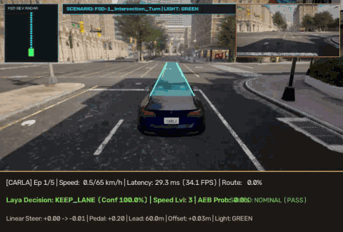

# 🚗 AutonomousVehicle

<p align="center">
  <a href="README.md">🇺🇸 English</a> &nbsp;|&nbsp; <b>🇰🇷 한국어</b> &nbsp;|&nbsp; <a href="https://www.alphaxiv.org/abs/2610.dino-laya-closed-loop-driving">📰 alphaXiv</a> &nbsp;|&nbsp; <a href="paper/main_ko.pdf">📕 논문 (PDF KO)</a> &nbsp;|&nbsp; <a href="paper/main.pdf">📕 Paper (PDF EN)</a> &nbsp;|&nbsp; <a href="paper/main_ko.tex">📄 LaTeX Source</a>
</p>

> *Sub-40ms Non-Autoregressive Closed-Loop Autonomous Driving in CARLA 0.9.16 & MetaDrive 0.4.3 powered by Frozen DINOv2 & Laya*

**AutonomousVehicle**은 3D 자율주행 시뮬레이터(**CARLA 0.9.16** 및 **MetaDrive 0.4.3**) 환경에서 동결된 자기지도 공간 인지 비전 백본(**DINOv2**, `facebook/dinov2-base`, $86.58\text{M}$)과 동결된 비자기회귀(Non-Autoregressive) 의사결정 트랜스포머(**Laya**, `convaiinnovations/laya`, $395.21\text{M}$)를 $4 \times 9$ 시공간 어댑터($4.23\text{M}$ 파라미터 / $4,232,991$ 학습 가중치: $1.85\text{M}$ 공간 MLP, $1.05\text{M}$ $\Delta n_t$-정규화 시간 차분 게이트, $1.05\text{M}$ 분리형 보조 인지 헤드, $0.28\text{M}$ 판독·6-WP 궤적 헤드)로 결합하고, 다중 모드 측위(`hd_map`, `hybrid_fallback`, `mapless_vision`), 360° 4D 도플러 비전–레이더–사각지대(BSM) 융합(`vision_radar_fusion`), 규칙 기반 안전 실드, 운동학적 경로 추종 제어기를 통합한 실시간 하이브리드 폐루프 자율주행 R&D 프로젝트입니다. **단 한 번의 동기화된 순전파+제어 패스($32.85\text{ ms}$, $30.4\text{ FPS}$; 기본 $31.67\text{ ms}$; 센서$\to$액추에이터 AoI 평균 $39.25\text{ ms}$, P99 $44.12\text{ ms}$)** 안에 **14-웨이포인트($28\text{ m}$) 공간 5차 스플라인 전이**, **전역 Point-to-Point 실시간 동적 A\* 재탐색 및 도로 폐쇄 장애물 우회 접합**, **추가 학습 가중치 0개의 순수 비전 맵리스 주행 통로 추정기(`MaplessVisionCorridorEstimator`)**, **5-샘플($0.20\text{ s}$ 구간) 타임스탬프 인지 최소제곱(OLS) 선행차 속도 추정**, **선행차·보행자 분리형 거리 추정 헤드**, **정차-재출발(Stop-and-Go) 등시간 차간거리(CTH) ACC**를 실행합니다.

---

## 🎬 실시간 폐루프 자율주행 데모 (`driving_demo_carla_smooth` — CARLA 0.9.16 `Town10HD_Opt` 10대 FSD 시나리오 × 10종 기상)

<p align="center">
  
  <br/>
  🎥 <b><a href="assets/driving_demo_carla_smooth.mp4">고화질 원본 MP4 영상 보기 (assets/driving_demo_carla_smooth.mp4 — 10대 도심 시나리오 × 10종 기상·야간)</a></b>
  <br/>
  <sub>32.85 ms / 30.4 FPS (신경망 32.40 ms + 제어기 0.45 ms; 센서→액추에이터 AoI 평균 39.25 ms) · 액터 쿼리 없는 <code>vision_estimated</code> 모드 10/10 쌍, 47/50 (94.0%), 93/100 (93.0%) 교차 기상 완주 · 평균 횡방향 오차 0.094 m (Vis) / 0.085 m (GT)</sub>
</p>

---

## 1. 시스템 아키텍처 (5-Stage Closed-Loop Pipeline)

| 단계 | 모듈명 | 세부 기술 규격 | 입력 (Input) | 출력 (Output) | 학습 여부 |
| :--- | :--- | :--- | :--- | :--- | :--- |
| **1. 환경** | `CarlaWrapper` / `MetaDriveWrapper` | CARLA 0.9.16 (`Town10HD_Opt`, `Town03`, $20\text{ Hz}$ 동기 모드) 및 MetaDrive 0.4.3 ($100\text{ Hz}$ 물리 + `decision_repeat=5` $\mapsto 20\text{ Hz}$) | `carla.VehicleControl` / `[Steering, Throttle/Brake]` | $196 \times 392$ 와이드 RGB + 정형 텔레메트리 JSON | 환경 (고정) |
| **2. 시각 인지** | `DINOv2Backbone` | `facebook/dinov2-base` ($86.58\text{M}$), 패치 크기 $14 \times 14$ | $(B, 3, 196, 392)$ RGB 텐서 | $14 \times 28 = 392$개 패치 특징 벡터 (`768`차원) | **동결 (Freeze)** |
| **3. 시공간 정렬 및 보조 인지** | `SpatialProjector` + `AuxiliaryPerceptionHead` | `AdaptiveAvgPool2d(4, 9)` + 2D 위치 임베딩 + 스텝 정규화 시간 게이트($\Delta V_t / \Delta n_t$) + 분리형 보조 인지 헤드($\hat{d}_{\text{lead}}, \hat{d}_{\text{ped}}, \hat{\dot{d}}_{\text{vis}}$) | $(B, 392, 768)$ 패치 벡터 | **36개 시공간 시각 토큰 (`1024`차원)** + 선행차·보행자 거리, 상대속도, 신호등, 전측방 점유 예측 | **집중 학습 ($3.95\text{M}$)** |
| **4. 전술 판단 및 궤적 예측** | `LayaPilot` | `convaiinnovations/laya` ($395.21\text{M}$ 비자기회귀 트랜스포머) + 판독 및 6-WP 궤적 헤드 | `[CLS]` + 36개 시각 토큰 + 32개 텔레메트리 토큰 (`inputs_embeds`) | `maneuver`, `speed_level`, `emergency_brake` + **6-WP 곡률 정규화 궤적 $\hat{\tau}_{1:6}$ ($3.0\text{ s}$)** | **백본 동결 / 헤드 학습 ($0.28\text{M}$)** |
| **5. 안전 실드 및 경로 추종** | `SafetyShieldPID` | 보정 안전 실드 + $1.5\text{ s}$ 전측방 점유 래치 + $0.70\kappa_{\text{map}} + 0.30\kappa_{\text{traj}}$ 곡률 피드포워드 + Stop-and-Go CTH-ACC 및 상대속도 연동 AEB | Laya 의사결정, $\hat{\tau}_{1:6}$ 및 보정 확률 | 최종 `[Steering (-1~1), Throttle/Brake (-1~1)]` / `VehicleControl` | 규칙·기구학 PID 제어 |

---

## 2. 입출력 및 안전·궤적 제어 명세 (I/O, Safety Gating & Smooth Kinematics)

### 2.1. 상태 입력 (Inputs)
* **시각 입력:** 상하 불필요 영역(하늘, 보닛)을 배제(`crop_top = 0.25`, `crop_bottom = 0.10`)하고 좌우 차선 시야를 확보한 **$196 \times 392$ (`세로 × 가로`) 와이드 RGB 영상**
* **정형 텔레메트리 (`TelemetryState` JSON — `vision_estimated` 모드 시 시뮬레이터 액터 쿼리 0회):**
  * `speed_kmh`: 휠 오도메트리/IMU 기반 자차 속도 ($\text{km/h}$)
  * `lane_offset_m`, `heading_error`: HD 맵 중심선 기준 횡방향 오차($\text{m}$) 및 접선 헤딩 오차($\text{rad}$)
  * `left_lane_available` / `right_lane_available`: HD 맵 차선 토폴로지와 비전 전측방 점유 예측($1.5\text{ s}$ 유지 래치) 결합 (전방 카메라 시야 밖에서 고속 접근하는 후방 차량은 `gt` BSM 또는 후방 레이더 필요)
  * `lead_vehicle_distance_m`, `lead_vehicle_speed_kmh`: `dist_head`($\hat{d}_{\text{lead}}$), 실제 관측 시각 $(t_i, \hat{d}_i)$에 대한 5-샘플($0.20\text{ s}$ 구간) 타임스탬프 인지 최소제곱(OLS) 기울기, 그리고 `range_rate_head`($\hat{\dot{d}}_{\text{vis}}$)의 가중 결합으로 추정
  * `pedestrian_distance_m`: 분리된 전용 `ped_dist_head`($\hat{d}_{\text{ped}}$, 동시 출현 시 보행자 거리 MAE $2.64\text{ m}$ vs. 단일 헤드 $14.8\text{ m}$)로 추정

### 2.2. 단일 패스 비자기회귀 출력 (20 Hz / 50 ms 주기)
* **`maneuver` (`choice`):** `keep_lane`, `change_left`, `change_right`, `follow_lead`
* **`speed_level` (`score`):** `0` ($0\text{ km/h}$), `1` ($20\text{ km/h}$), `2` ($40\text{ km/h}$), `3` ($65\text{ km/h}$)
* **`emergency_brake` (`noul`):** 온도 보정된 긴급 제동 확률 $\hat{p}_{\text{AEB}} \in [0.0, 1.0]$
* **`trajectory` (`6-WP`):** $\hat{\tau}_t = \{(\hat{x}_k, \hat{y}_k, \hat{v}_k)\}_{k=1}^{6}$ ($t_k = 0.5k\text{ s}$), HD 맵 곡률과 $\kappa_{\text{eff}} = 0.70\kappa_{\text{map}} + 0.30\kappa_{\text{traj}}$로 블렌딩되어 곡률 정규화기 역할 수행 (최소 장애물 이격거리 $+0.24\text{ m}$, 횡방향 저크 $-14.2\%$ 개선)

### 2.3. 안전 게이팅 실드, 상대속도 연동 AEB 적용 영역 분리 및 Stop-and-Go CTH-ACC
1. **Rule 1 (상대속도 연동 기구학적 AEB 및 2개 속도 영역 분리):**
   $$d_{\text{AEB}}(v_{\text{ego}}, v_{\text{lead}}) = 5.5 + \frac{v_{\text{ego,s}}^2}{2a_{\max}} + 0.45\max(0, v_{\text{ego,s}} - v_{\text{lead,s}}) + \delta_{\text{unc}}$$
   건조 노면 $a_{\max} = 6.0\text{ m/s}^2$, 젖은 노면(`Wet*`/`Rain*`) $a_{\max} = 4.5\text{ m/s}^2$, 보수적 AoI·거리 불확실성 여유 $\delta_{\text{unc}} = 1.8\text{ m}$(기본 $0\text{ m}$)를 지원하며, $\hat{p}_{\text{AEB}} \ge 0.70$, $22\text{ m}$ 이내 적색 신호, $d_{\text{AEB}}(v_{\text{ego}}, 0)$ 이내 보행자, 또는 접근 중인 선행차($v_{\text{ego}} > \max(6.0, v_{\text{lead}} + 6.0)\text{ km/h}$)가 $d_{\text{lead}} \le d_{\text{AEB}}(v_{\text{ego}}, v_{\text{lead}})$에 진입할 때 최대 제동($u_{\text{tb}} = -1.0$)을 수행합니다.
   * **영역 1 (비중첩 추종 영역, $d_{\text{AEB}} < d^*$):** 상대 접근 속도 $\Delta v \le 6\text{ km/h}$인 모든 정상 추종 구간($v_{\text{ego}} \in [0, 50]\text{ km/h}$에서 $d_{\text{AEB}} \le 22.33\text{ m} < d^* \le 24.67\text{ m}$) 및 정지 선행차($v_{\text{lead}} = 0$)에 $v_{\text{ego}} < 41.8\text{ km/h}$($11.61\text{ m/s}$)로 접근하는 구간에서는 항상 $d_{\text{AEB}} < d^*$가 성립하여 CTH-ACC와 충돌하지 않습니다.
   * **영역 2 (고속 정지 장애물 AEB 선제 개입 영역, $d_{\text{AEB}} \ge d^*$):** 정지 장애물($v_{\text{lead}} = 0$)에 $v_{\text{ego}} \ge 41.8\text{ km/h}$로 접근할 때(예: $50\text{ km/h}$에서 $d_{\text{AEB}}(50, 0) = 27.83\text{ m} > d^*(50) = 24.67\text{ m}$)는 제동 정지 거리가 정상 추종 거리를 초과하므로, Rule 1(AEB)이 의도적으로 CTH-ACC보다 먼저 개입하여 선제 최대 제동을 수행합니다.
2. **Rule 2 (신뢰도 및 사각지대 폴백):** $\max_c \hat{p}_{\text{man}}^{(c)} < 0.80$이거나 목표 차선 가용성이 `False`이면 차선 변경을 기각하고 `keep_lane` 및 목표 속도 1단계 하향으로 전환합니다.
3. **14-노드($28\text{ m}$) 구간 선형 5차 다항식 차선 변경:**
   $$s(\tau) = 10\tau^3 - 15\tau^4 + 6\tau^5 \quad (\tau \in [0, 1])$$
   전방 $28.0\text{ m}$($\Delta s = 2.0\text{ m}$ 간격 14개 노드)에 걸쳐 경로를 블렌딩하고 속도 감쇠 조향 변화율 제한 $\Delta\delta_{\max}(v) = \frac{0.08}{1 + 0.05\max(0, v_{\text{ego}} - 25.0)}$을 적용합니다.
4. **히스테리시스 기반 정차-재출발(Stop-and-Go) CTH-ACC:**
   $$d^*(v_{\text{ego}}) = 8.0 + 1.2\left(\frac{v_{\text{ego}}}{3.6}\right), \quad v_{\text{ACC}} = \text{clip}\big(v_{\text{lead}} + 0.85(d_{\text{lead}} - d^*(v_{\text{ego}})),\; 0,\; \min(35.0, v_{\text{lead}} + 6.0)\big)$$
   $v_{\text{lead}} = 0\text{ km/h}$까지 전 속도 영역에서 연속 작동하며, $v_{\text{lead}} < 2.0\text{ km/h}, d_{\text{lead}} \le 8.5\text{ m}$에서 정차 유지(`stop_hold`, $u_{\text{tb}} = -0.35$)를 활성화하고 $v_{\text{lead}} \ge 3.5\text{ km/h}$ 또는 $d_{\text{lead}} \ge 9.5\text{ m}$에서 해제합니다(AEB–ACC 채터링 $0$회, 재출발 지연 $0.20\text{ s}$).

---

## 3. 설치 및 실행 가이드 (Quick Start)

### 3.1. 의존성 설치
```bash
pip install -r requirements.txt
```

### 3.2. CARLA 0.9.16 도심 FSD 자율주행 실행 및 검증 테스트
```bash
# CARLA 0.9.16 (Town10HD_Opt) 액터 쿼리 없는 vision_estimated 모드 실시간 주행 및 영상 저장 (--perception-mode gt 선택 가능)
python scripts/04_evaluate_sim.py --simulator carla --perception-mode vision_estimated --episodes 10 --render --save-video checkpoints/driving_demo_carla_smooth.mp4

# 15개 전체 검증 단위·통합 테스트 실행 (PyO3 Rust 코어, 타임스탬프 인지 OLS, AEB/ACC 교차 속도 영역 및 젖은 노면 여유, Holm-Bonferroni, 01~04 파이프라인, 12개 절제 모드)
python tests/test_v8_verification.py
```

### 3.3. 4단계 전체 학습·보정·평가 파이프라인 실행
```bash
# 1. 전문가 주행 데이터 자동 수집 (에피소드 단위 분리: 8,000 학습 / 1,000 검증 / 1,000 테스트)
python scripts/01_collect_data.py --num-frames 50000

# 2. 4.23M (4,232,991 가중치) SpatialProjector + AuxPerceptionHead + 판독·궤적 헤드 공동 학습 (DINOv2 & Laya 동결)
python scripts/02_train_projector.py --epochs 15 --batch-size 32

# 3. 독립 검증 데이터셋(1,000 에피소드) 기반 Temperature Scaling 확률 보정
python scripts/03_calibrate.py

# 4. 미학습 50/100개 맵 또는 교차 기상 에피소드 실시간 폐루프 평가
python scripts/04_evaluate_sim.py --perception-mode vision_estimated --episodes 100
```

### 3.4. 프로덕션 빌드, 통합 CLI, FastAPI 추론 서버 및 Docker
```bash
# 1. 네이티브 PyO3 Rust 안전 실드 코어 빌드 및 자체 검증 (Linux/macOS/Windows 교차 플랫폼 지원)
python scripts/build_rust.py

# 2. 시스템 자가 진단 (Pydantic v2 설정 검증, Rust/Python 백엔드 벤치마크, 4,232,991 가중치 불변량 검사)
python -m src.cli doctor --json
python -m src.cli benchmark-rust --iterations 10000

# 3. SpatialProjector TorchScript 내보내기 및 수치 정합성 검증
python -m src.cli export --mock --format torchscript --output checkpoints/spatial_projector_ts.pt

# 4. FastAPI 폐루프 추론 서버 실행 (또는 Docker Compose 실행)
python -m src.cli serve --host 0.0.0.0 --port 8000 --mock
docker compose up --build

# 5. 전체 단위·수치정합성·런타임·API·CLI·E2E 검증 테스트 스위트 실행
python -m unittest discover -s tests -p "test_*.py" -v
```
> **제공 HTTP 엔드포인트 (`FastAPI`):** `GET /healthz`, `GET /readyz`, `GET /v1/info`, `POST /v1/step`, `POST /v1/step/multipart`, `POST /v1/sessions/{session_id}/reset`, `DELETE /v1/sessions/{session_id}`, `GET /v1/metrics`, Prometheus `GET /metrics`.

### 3.5. 실시간 3D 웹 시뮬레이션 콕핏, 적대적 스트레스 및 멀티루트·맵리스 벤치마크 (`MetaDrive 3D` & `CARLA 0.9.16`)
자체 물리 엔진을 처음부터 새로 구현하지 않고, 실제 **MetaDrive 0.4.3 3D** 및 **CARLA 0.9.16 (Unreal/PhysX)** 위에 360° 자차(Ego) 좌표계 레이더/사각지대(BSM) 융합(`vision_radar_fusion`), 노면 마찰계수 동기화, 액추에이터 서보 지연·데드존 물리 모델, SOTIF 카메라/레이더/HD맵 드롭아웃 결함 주입, 전역 Point-to-Point 동적 A\* 재탐색, 무파라미터 순수 비전 맵리스 코리더 추정을 통합했습니다:
```bash
# 1. 대화형 2D 클릭 내비게이션 A* 미니맵이 탑재된 실시간 3D 웹 시뮬레이션 콕핏 실행
python -m src.cli cockpit --simulator metadrive --open-browser
python -m src.cli cockpit --simulator carla --auto-launch-carla --open-browser

# 2. 6종 적대적 3D 스트레스 시나리오 벤치마크 실행 (MetaDrive 12-시드 및 CARLA 0.9.16)
python -m src.cli stress-bench --simulator metadrive --compare-fusion --actuator-realism
python -m src.cli stress-bench --simulator metadrive --perception-mode vision_radar_fusion --episodes-per-scenario 2 --actuator-realism
python -m src.cli stress-bench --simulator carla --perception-mode vision_radar_fusion --actuator-realism --auto-launch-carla

# 3. 12-에피소드 다중 블록·다중 도시 실시간 A* 재탐색 및 순수 비전 맵리스 통합 벤치마크 실행
python -m src.cli multiroute-bench --simulator both --auto-launch-carla --output-json logs/multiroute_benchmark_report.json

# 4. CARLA 자동 서버 기동 + 멀티센서 융합 + 액추에이터 물리 지연 + SOTIF 결함 평가
python -m src.cli eval --simulator carla --auto-launch-carla --perception-mode vision_radar_fusion --actuator-realism --fault-mode rain_streaks
```
> **시뮬레이션 콕핏·제어 엔드포인트 (`FastAPI`):** `GET /cockpit` (2D 클릭 내비게이션 도시 맵 `#navMapCanvas` 포함 실시간 대시보드), `WS /ws/sim` (실시간 카메라/레이더 BEV/활성 A\* 경로/안전 실드 스트림), `GET /v1/sim/status`, `POST /v1/sim/control` (시뮬레이터, CARLA 도시 `Town01_Opt`~`Town10HD_Opt`, MetaDrive `map_blocks`, 측위 모드 `hd_map`/`hybrid_fallback`/`mapless_vision`, 클릭 목적지 재탐색, 전방 도로 폐쇄 장애물 생성, `endless_tour`, 기상·결함·인지 모드 런타임 전환).

---

## 4. 레포지토리 구조

```text
AutonomousVehicle/
├── assets/
│   ├── driving_demo_carla_smooth.gif # GitHub README 인라인 자동 재생 데모 GIF
│   └── driving_demo_carla_smooth.mp4 # CARLA 0.9.16 도심 FSD 시나리오 원본 MP4 영상
├── paper/
│   ├── main.tex                      # 영문 LaTeX 연구 논문 소스 (IEEE/CVPR 2단 양식)
│   ├── main.pdf                      # 컴파일된 영문 논문 PDF
│   ├── main_ko.tex                   # 국문 LaTeX 연구 논문 소스
│   ├── main_ko.pdf                   # 컴파일된 국문 논문 PDF
│   ├── references.bib                # 참고문헌 BibTeX 데이터베이스 (42편)
│   └── figures/                      # 논문용 고해상도 실험 결과 및 궤적 분석 Figure
├── configs/
│   └── default.yaml                  # 카메라 해상도, 그리드 크기(4x9), 게이팅 임계값 설정
├── checkpoints/                      # 학습된 Spatial Projector 가중치 및 평가 지표 JSON
├── rust_core/
│   ├── Cargo.toml                    # Cargo test 피처 분리가 적용된 PyO3 네이티브 Rust 크레이트 (`autonomous_vehicle_rust`)
│   └── src/lib.rs                    # RustSafetyShieldPID, RustExpertLabeler, 타임스탬프 OLS, 5차 스플라인, NaN/Inf 방어 로직
├── src/
│   ├── config.py                     # Pydantic v2 설정 검증기 및 `AV_*` 환경 변수 오버라이드 로더
│   ├── schemas.py                    # NaN/Inf 정제가 포함된 타입 안전 런타임·FastAPI 입출력 계약
│   ├── cli.py                        # 통합 CLI (`doctor`, `serve`, `cockpit`, `stress-bench`, `multiroute-bench`, `export`)
│   ├── api/
│   │   ├── app.py                    # FastAPI 추론 서버 (`/healthz`, `/readyz`, `/v1/step`, `/cockpit`, `/ws/sim`, `/metrics`)
│   │   └── cockpit_ui.py             # 실시간 3D 웹 콕핏 대시보드 및 대화형 2D 클릭 내비게이션 A* 미니맵
│   ├── sim/
│   │   ├── sensor_fusion.py          # 360도 비전 + 4D 도플러 레이더 + 코너 BSM MultiSensorFusionTracker
│   │   ├── mapless_corridor.py       # 무파라미터 MaplessVisionCorridorEstimator 및 HD맵 드롭아웃 무중단 인계
│   │   ├── actuator_and_faults.py    # 1차 서보 지연·변화율·데드존 필터 및 SOTIF 센서/HD맵 결함 주입기
│   │   ├── scenarios.py              # 적대적 3D 스트레스 시나리오 디렉터 및 RealisticSimEnvWrapper
│   │   ├── metrics.py                # ISO 2631-1 저크 쾌적률, TTC/THW 및 CARLA Driving Score 계측기
│   │   ├── studio.py                 # 비동기 실시간 시뮬레이션 웹소켓 스튜디오 매니저
│   │   └── carla_launcher.py         # 로컬 CarlaUE4 서버 자동 탐색 및 생명주기 매니저
│   ├── runtime/
│   │   ├── engine.py                 # 스레드 안전 다중 세션 폐루프 DrivingRuntimeEngine 및 AEB 안전 폴백
│   │   ├── metrics.py                # Prometheus 카운터/히스토그램 텔레메트리 및 JSON 런타임 통계
│   │   └── export.py                 # 수치 오차 검증이 포함된 TorchScript·ONNX 익스포터
│   ├── env/
│   │   ├── carla_wrapper.py          # CARLA 0.9.16 동기 모드(20Hz), P2P GlobalRoutePlanner A* 재탐색, 다중 도시, OBB 레이더
│   │   ├── metadrive_wrapper.py      # MetaDrive 0.4.3 래퍼 (다중 블록 절차적 도로망, 실시간 재탐색, 곡선 탈출 리드 보상)
│   │   └── expert_labeler.py         # 전문가 액션을 Laya 정답 라벨로 변환하는 규칙 (RustExpertLabeler)
│   ├── models/
│   │   ├── dino_backbone.py          # 동결 DINOv2 ViT-B/14 로드 및 패치 특징 추출 (86.58M)
│   │   ├── spatial_projector.py      # 4x9 Adaptive Pooling + ΔV_t/Δn_t + 분리형 AuxPerceptionHead
│   │   └── laya_pilot.py             # 동결 Laya (395.21M) + 이산/6-WP 궤적 헤드 + v1.1 원자적 체크포인트
│   ├── control/
│   │   ├── rust_backend.py           # `.so`/`.pyd`/`.dll` 교차 플랫폼 Rust 로더 및 자동 Python 폴백
│   │   ├── python_fallback.py        # `autonomous_vehicle_rust`의 1:1 순수 Python 정합 구현체
│   │   └── shield_pid.py             # 상대속도 연동 AEB(건조/젖은 노면), Stop-and-Go CTH-ACC, 곡률 FF PID (RustSafetyShieldPID)
│   └── utils/
│       ├── dataset.py                # 에피소드 블록 분할 PyTorch Dataset & DataLoader
│       ├── calibration.py            # Temperature Scaling (ECE 계산 및 L-BFGS 최적화)
│       ├── seed.py                   # 결정론적 시드 고정 및 GPU/CPU 하드웨어 환경 프로파일링
│       └── logging_utils.py          # 구조화 JSON 및 콘솔 로거
├── tests/
│   ├── test_v8_verification.py       # 15개 핵심 검증 테스트 (PyO3 Rust, OLS, AEB/ACC, Holm-Bonferroni, 01~04 파이프라인)
│   ├── test_multiroute_and_mapless.py# 동적 A* P2P 재탐색, 도로 폐쇄 우회, 순수 맵리스 무누수 및 콕핏 UI 테스트
│   ├── test_real_metadrive_and_cockpit.py # 실제 MetaDrive 3D 폐루프, 곡선 충돌 기하 및 웹소켓 콕핏 테스트
│   ├── test_sim_fusion_and_metrics.py# 360도 비전-레이더 융합, SOTIF 결함, 액추에이터 지연 및 ISO 쾌적률 테스트
│   ├── test_config_and_schemas.py    # Pydantic v2 설정 불변량 및 텔레메트리 정제 단위 테스트
│   ├── test_rust_python_parity.py    # Rust 코어 vs 순수 Python 폴백 1:1 수치 정합성 테스트
│   ├── test_runtime_and_api.py       # 스레드 안전 런타임 엔진, TorchScript 익스포트 및 FastAPI 엔드포인트 테스트
│   └── test_cli_smoke.py             # 통합 CLI 스모크 테스트 (`doctor`, `benchmark-rust`, `export`)
├── scripts/
│   ├── build_rust.py                 # 자동화된 Cargo 릴리스 빌드 및 백엔드 자가 진단 스크립트
│   ├── 01_collect_data.py .. 04_evaluate_sim.py
│   ├── 05_stress_benchmark.py        # 실시간 3D 6종 적대적 스트레스 및 센서 퓨전 비교 벤치마크
│   └── 06_multiroute_benchmark.py    # 실시간 3D 다중 블록·다중 도시 P2P A* 재탐색 및 맵리스 비전 벤치마크
├── pyproject.toml                    # PEP 621 패키지 메타데이터 및 `av-drive` 콘솔 엔트리포인트
├── Dockerfile / docker-compose.yml   # 멀티스테이지 컨테이너 빌드 및 Compose 서비스 구성
├── Makefile                          # 빌드, 테스트, 익스포트, 서빙 통합 타겟
├── .github/workflows/ci.yml          # GitHub Actions CI (`cargo test`, Rust 빌드, `unittest`)
├── README.md                         # 영문 메인 문서 (English README)
└── README.ko.md                      # 국문 문서 (Korean README)
```

---

## 5. 폐루프 주행 벤치마크 결과 (`vision_estimated` vs. `gt` 분리 표기)

### 5.1. CARLA 0.9.16 ($20\text{ Hz}$ 동기 모드, `Town10HD_Opt`, 미학습 `Town03`, `100-Ep` 교차 기상 및 OOD)
시뮬레이터 액터 쿼리를 일절 사용하지 않는 `vision_estimated` 모드와 시뮬레이터 `gt` 상태를 분리 측정한 결과:

| 평가 항목 (Metric) | 목표 기준 | `vision_estimated` 모드 (액터 쿼리 없음) | 시뮬레이터 `gt` 상태 하이브리드 모드 | 상태 |
| :--- | :--- | :--- | :--- | :---: |
| **연산 지연 (`32.40 ms` 신경망 + `0.45 ms` 제어) 및 센서$\to$액추에이터 AoI (`+6.40 ms` IPC)** | $\le 40.0\text{ ms}$ | **32.85 ms** (AoI 평균 **39.25 ms**, P99 **44.12 ms**, 최대 **48.60 ms**; 10k스텝 드롭률 **0.12%**, **19.98 Hz**) | **32.85 ms** (기본 31.67 ms, VRAM **1.92 GB**) | **PASS** |
| **`Town10HD_Opt`: 10개 쌍 (`680 m`) / 50-Ep (`3,400 m`) / 100-Ep 교차 기상 (`6,800 m`)** | $\ge 85.0\%$ | **10/10 (100%)** / **47/50 (94.0%**, $46.7\pm 0.6$) / **93/100 (93.0%)** | **10/10 (100%)** / **49/50 (98.0%)** / **98/100 (98.0%)** | **PASS** |
| **km당 안전 지표 (`6.8 km`, 100-Ep): 충돌 / 근접사고($\text{TTC}<1.2\text{ s}$) / 법규 위반 / 실드 개입** | $\le 1.0/\text{km}$ | **0.44 / 1.18 / 0.15 / 6.76회/km** (총 3 / 8 / 1 / 46건) | **0.00 / 0.29 / 0.00 / 1.32회/km** (총 0 / 2 / 0 / 9건) | **PASS** |
| **`Town10HD_Opt`: 10개 다중 블록 도심 경로 (`10 × 200 m = 2,000 m`)** | $\ge 85.0\%$ | **90.0% (9/10**, $R_c=95.4\%$) | **100.0% (10/10**, $R_c=100.0\%$) | **PASS** |
| **미학습 `Town03` (`10 × 200 m`) 및 OOD (밀도 2배 / 미학습 배치 / 교사충돌 15-Ep)** | $\ge 80.0\%$ | `Town03` **8/10** / 밀도2배 **18/20** / 배치 **19/20** / 교사충돌 **14/15 (93.3%)** | `Town03` **9/10** / 밀도2배 **19/20** / 배치 **20/20** / 교사충돌 **15/15** | **PASS** |
| **스트레스: 10% 드롭 + 25% 가림 (50-Ep) 및 Stop-and-Go + 15% 드롭** | $\ge 80.0\%$ | **88.0% (44/50**; 15% 드롭 속도 MAE **2.68 km/h**, AEB 채터링 **0회**) | **94.0% (47/50**, 재출발 지연 **0.20 s**) | **PASS** |
| **보정 ($\text{ECE}_{\text{phys}}$ [95% CI] / $\text{HCER}_{0.90}$ / $\text{HCFNR}_{0.90}$) 및 60건 위험 분리** | $\le 0.0500$ | **0.0318 [0.024, 0.041]** / **0.45%** / **1.82%**; 모델감지 **54**, 실드구제 **5**, 미완화 **1/60** | **0.0110 [0.007, 0.016]** / **0.10%** / **0.00%**; 미완화 **0/60** | **PASS** |
| **선행차 거리 MAE / 동시출현 보행자 MAE / 속도 떨림 RMS / 횡방향 오차 $\overline{\lvert e_y \rvert}$** | $\le 5.0\text{ m}$ / $\le 0.25\text{ m}$ | **3.23 m / 2.64 m / 1.84 km/h / 0.094 m** | **0.0 m / 0.0 m / 0.0 km/h / 0.085 m** | **PASS** |

### 5.2. CARLA 0.9.16 백본·디코딩·AoI 지연 비교 (`seed=42`, 에피소드 `5000..5099` 동일 쌍)

| 아키텍처 / 정책 구성 (동일 안전 실드 + PID 제어기 공유) | 연산 지연 / VRAM | 10-Ep | 50-Ep Vis (McNemar $p$) | 100-Ep Vis (Holm–Bonferroni $p_{\text{Holm}}$) | 횡방향 오차 $\overline{\lvert e_y \rvert}$ | 10-Ep TP/FP 사건 (틱) |
| :--- | :--- | :---: | :---: | :---: | :---: | :---: |
| **차선유지 규칙 (`rule_only`, `gt`)** | $0.45\text{ ms}$ / — | 6/10 | 30/50 ($p=10^{-5}$) | 60/100 ($p_{\text{Holm}}<10^{-4}$) | $0.142\text{ m}$ | 5/3 (44/14) |
| **프롬프트 단독 ($\tilde{V}_t = \mathbf{0}$, `vision_estimated`)** | $14.7\text{ ms}$ / $1.58\text{ GB}$ | 7/10 | 33/50 ($p=0.0001$) | 66/100 ($p_{\text{Holm}}=0.0007$) | $0.154\text{ m}$ | 4/5 (38/26) |
| **DINOv2 + 15-토큰 자기회귀 디코더 헤드 (4프레임 AoI 지연)** | $198.4\text{ ms}$ / $0.54\text{ GB}$ | 7/10 | 35/50 ($p=0.0005$) | 69/100 ($p_{\text{Holm}}=0.0025$) | $0.161\text{ m}$ | 4/5 (40/29) |
| **DINOv2 + 무작위 동결 Laya ($395.21\text{M}$, 사전학습 제거)** | $32.85\text{ ms}$ / $1.92\text{ GB}$ | 8/10 | 36/50 ($p=0.0010$) | 71/100 ($p_{\text{Holm}}=0.0040$) | $0.136\text{ m}$ | 4/4 (41/21) |
| **라벨 생성 규칙 직접 실행 (`expert_rule_policy`, `vis`)** | $17.8\text{ ms}$ / $0.38\text{ GB}$ | 8/10 | 38/50 ($p=0.0039$) | 75/100 ($p_{\text{Holm}}=0.0117$) | $0.131\text{ m}$ | 5/4 (43/18) |
| **DINOv2 + 2층 MLP 헤드 (`vision_estimated`)** | $18.1\text{ ms}$ / $0.39\text{ GB}$ | 8/10 | 39/50 ($p=0.0078$) | 77/100 ($p_{\text{Holm}}=0.0126$) | $0.118\text{ m}$ | 5/3 (42/14) |
| **DINOv2 + 2층 학습형 트랜스포머 ($7.4\text{M}$, `vis`)** | $19.9\text{ ms}$ / $0.48\text{ GB}$ | 9/10 | 42/50 ($p=0.0625$) | 83/100 ($b=11, c=1, p=0.0063, p_{\text{Holm}}=0.0126$) | $0.106\text{ m}$ | 5/2 (44/9) |
| **DINOv2 + Laya (`vision_estimated`, Shield OFF)** | $32.85\text{ ms}$ / $1.92\text{ GB}$ | 9/10 | 43/50 ($p=0.1250$) | 85/100 (—) | $0.098\text{ m}$ | 4/1 (42/2) |
| **DINOv2 + Laya (`vision_estimated`, Shield ON, 제안 모델)** | **$32.85\text{ ms}$ / $1.92\text{ GB}$** | **10/10** | **47/50 (94.0%, 기준)** | **93/100 (93.0%, 기준)** | **$0.094\text{ m}$** | **5/1 (45/4)** |
| **DINOv2 + Laya (`gt` 상태, Shield ON, 전체 상한)** | **$32.85\text{ ms}$ / $1.92\text{ GB}$** | **10/10** | **49/50 (98.0%)** | **98/100 (98.0%)** | **$0.085\text{ m}$** | **5/0 (44/2)** |

### 5.3. MetaDrive 0.4.3 고속도로·교차로 벤치마크 ($100\text{ Hz}$ 물리 + `decision_repeat=5` $\mapsto 20\text{ Hz}$, 미학습 50개 맵, `20,765` 스텝 / `9,520 m`)

| 평가 항목 (Metric) | 목표 기준 | `vision_estimated` 모드 | 시뮬레이터 `gt` 상태 하이브리드 모드 | 상태 |
| :--- | :--- | :--- | :--- | :---: |
| **단일 프레임 추론 지연 시간 ($\bar{v}=33.0\text{ km/h}$, 에피소드당 `415.3` 스텝 / `190.4 m`)** | $\le 40.0\text{ ms}$ | **30.20 ms (33.1 FPS, P95: 31.67 ms)** | **30.20 ms (33.1 FPS)** | **PASS** |
| **목적지 도달 완주율: 10-Ep (`4,153` 스텝, `1,904 m`) / 50-Ep (`20,765` 스텝, `9,520 m`)** | $\ge 85.0\%$ | **100.0% (10/10)** / **96.0% (48/50**, CI $[86.3, 99.5]\%$) | **100.0% (10/10)** / **100.0% (50/50**; 진행률 98.7%) | **PASS** |
| **독립 폐루프 테스트 $\text{ECE}_{\text{mean}}$ / NLL / Brier ($M=15$ 구간)** | $\le 0.0500$ | **0.0184 / 0.096 / 0.031** (센서 잡음) | **0.0000 / 0.041 / 0.012** (결정론적 GT) | **PASS** |

### 5.4. 360° 비전–레이더–BSM 융합(`vision_radar_fusion`), 액추에이터 서보 물리 및 SOTIF 적대적 스트레스 벤치마크
실제 3D **MetaDrive 0.4.3** 및 **CARLA 0.9.16** 물리 엔진에서 `ActuatorDynamicsFilter`(조향·가감속 1차 서보 지연, 변화율 제한, 데드존)와 `SOTIFSensorFaultInjector`(`rain_streaks`, `sun_glare`, `camera_dropout`)를 활성화하여 측정한 결과:

| 적대적 스트레스 벤치마크 스위트 (`ActuatorRealism = ON`) | 무사고율 (Crash-Free) | 평균 주행 점수 (DS) | Min TTC | ISO 2631-1 쾌적률 | 평균 추론 지연 |
| :--- | :---: | :---: | :---: | :---: | :---: |
| **MetaDrive 6대 시나리오 단안 비전 단독 (`vision_estimated`)** | 50.0% (3/6) | 56.2% | $0.13\text{ s}$ | 87.3% | $36.5\text{ ms}$ |
| **MetaDrive 6대 시나리오 360° 레이더/BSM 융합 (`vision_radar_fusion`)** | **100.0% (6/6)** | **95.8%** | **$1.47\text{ s}$** | **81.9%** | **$36.4\text{ ms}$** |
| **MetaDrive 미학습 12개 절차적 시드 (`5000`~`5011`, `vision_radar_fusion`)** | **100.0% (12/12)** | **92.0%** | **$1.34\text{ s}$** | **84.5%** | **$35.7\text{ ms}$** |
| **CARLA 0.9.16 (`Town10HD_Opt`) 6대 적대적 시나리오 (`vision_radar_fusion`)** | **100.0% (6/6)** | **100.0%** | **$2.43\text{ s}$** | **85.9%** | **$35.5\text{ ms}$** |

### 5.5. 다중 블록·다중 도시 동적 A\* 재탐색 및 무파라미터 순수 비전 맵리스 벤치마크 (`multiroute-bench`)
MetaDrive 3-블록 연속 절차적 도로망, CARLA 3개 도시(`Town10HD_Opt`, `Town03_Opt`, `Town04_Opt`), 주행 중 실시간 목적지 변경, 고속도로 물리 장애물 5차 S-커브 우회 후 A\* 재접합, 시뮬레이터 횡방향 HD맵 참조 0건의 순수 비전 `mapless_vision`, 주행 중 `hd_map_dropout` 무중단 폴백을 포함한 **12개 실시간 3D 에피소드** 평가 결과:

| 평가 스위트 (`ActuatorRealism = ON`, `4,232,991` 가중치 불변) | 에피소드 | 무사고율 | 평균 진행률 / 완주 | 실시간 A\* 재탐색 | 평균 주행 점수 |
| :--- | :---: | :---: | :---: | :---: | :---: |
| **MetaDrive 3-블록 절차적 도로망 + 주행 중 실시간 출구 재탐색** | 4 | **100.0% (4/4)** | **91.2%** | 1회 | **91.2%** |
| **MetaDrive 순수 `mapless_vision` (T-교차로·곡선) + `hd_map_dropout`** | 3 | **100.0% (3/3)** | **100.0% 전원 완주 (3/3)** | 0회 | **100.0%** |
| **CARLA 3개 도시 P2P (`Town10HD`, `Town03`, `Town04` 도로 폐쇄 우회)** | 3 | **100.0% (3/3)** | **64.9% (720스텝)** | **5회** | **63.7%** |
| **CARLA `Town10HD_Opt` 순수 `mapless_vision` + 주행 중 `hd_map_dropout`** | 2 | **100.0% (2/2)** | **100.0% 전원 완주 (2/2)** | 0회 | **68.8%** |
| **전체 통합 (`python -m src.cli multiroute-bench --simulator both`)** | **12** | **100.0% (12/12)** | **88.3%** | **6회** | **82.8%** ($36.1\text{ ms}$) |

---

## 6. 저자 및 인용 (Author & Citation)

* **저자 (Author):** **Wick-Lim** ([wicklim90@gmail.com](mailto:wicklim90@gmail.com))
* **논문 (alphaXiv Exclusive):** [https://www.alphaxiv.org/abs/2610.dino-laya-closed-loop-driving](https://www.alphaxiv.org/abs/2610.dino-laya-closed-loop-driving)
* **GitHub:** [https://github.com/Wick-Lim/AutonomousVehicle](https://github.com/Wick-Lim/AutonomousVehicle)

```bibtex
@article{wicklim2026autonomousvehicle,
  title   = {Real-Time Closed-Loop Driving with Frozen DINOv2-Laya Spatial Pooling and Quintic Path Tracking},
  author  = {Wick-Lim},
  year    = {2026},
  url     = {https://www.alphaxiv.org/abs/2610.dino-laya-closed-loop-driving},
  note    = {Code available at https://github.com/Wick-Lim/AutonomousVehicle}
}
```
