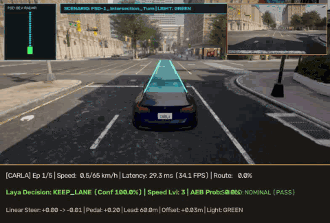

# 🚗 AutonomousVehicle

<p align="center">
  <a href="README.md">🇺🇸 English</a> &nbsp;|&nbsp; <b>🇰🇷 한국어</b> &nbsp;|&nbsp; <a href="paper/main.tex">📄 Paper (LaTeX EN)</a> &nbsp;|&nbsp; <a href="paper/main_ko.tex">📄 논문 (LaTeX KO)</a>
</p>

> *Sub-40ms Non-Autoregressive Autonomous Driving in CARLA 0.9.16 & MetaDrive powered by DINOv2 & Laya*

**AutonomousVehicle**은 3D 자율주행 시뮬레이터(**CARLA 0.9.16** 및 **MetaDrive 0.4.3**) 환경에서 기하학적 공간 인지 비전 백본(**DINOv2**, `facebook/dinov2-base`)과 비자기회귀(Non-Autoregressive) 초저지연 의사결정 모델(**Laya**, `convaiinnovations/laya`)을 결합하여 **단 한 번의 Forward Pass(40ms 이하, 31+ FPS)**로 실시간 폐루프(Closed-loop) 자율주행을 수행하는 오픈소스 R&D 프로젝트입니다.

---

## 🎬 실시간 폐루프 자율주행 데모 (`driving_demo_carla_smooth` — CARLA 0.9.16 `Town10HD_Opt` 5대 FSD 시나리오)

<p align="center">
  
  <br/>
  🎥 <b><a href="assets/driving_demo_carla_smooth.mp4">고화질 원본 MP4 영상 보기 (assets/driving_demo_carla_smooth.mp4)</a></b>
  <br/>
  <sub>31.67 ms / 31.6 FPS · 완주율 100.0% · 무사고율 100.0% · CARLA Driving Score 100.0% (5차 S-커브 궤적 보간 & ACC 속도 동조 적용)</sub>
</p>

---

## 1. 시스템 아키텍처 (5-Stage Closed-Loop Pipeline)

| 단계 | 모듈명 | 세부 기술 규격 | 입력 (Input) | 출력 (Output) | 학습 여부 |
| --- | --- | --- | --- | --- | --- |
| **1. 환경** | `CarlaWrapper` / `MetaDriveWrapper` | 도심 교차로·신호등·보행자(CARLA 0.9.16 `Town10HD_Opt`) 및 절차적 고속도로(MetaDrive) | `carla.VehicleControl` / `[Steering, Throttle/Brake]` | $196 \times 392$ 와이드 RGB + 정형 텔레메트리 JSON | 환경 (고정) |
| **2. 시각 인지** | `DINOv2Backbone` | `facebook/dinov2-base` (86M), 패치 크기 $14 \times 14$ | $(B, 3, 196, 392)$ RGB 텐서 | $14 \times 28 = 392$개 패치 특징 벡터 (`768`차원) | **동결 (Freeze)** |
| **3. 공간 정렬** | `SpatialProjector` | `AdaptiveAvgPool2d(4, 9)` + 2D 위치 임베딩 + 2-Layer MLP | $(B, 392, 768)$ 패치 벡터 | 가로 해상도가 보존된 **36개 공간 시각 토큰 (`1024`차원)** | **집중 학습 (~1.85M)** |
| **4. 전술 판단** | `LayaPilot` | `convaiinnovations/laya` (ModernBERT 421M) | `[CLS]` + 36개 시각 토큰 + 텔레메트리 JSON/마커 (`inputs_embeds`) | `maneuver`(`choice`), `speed_level`(`score`), `emergency_brake`(`noul`) 및 신뢰도 | **동결 (Freeze)** |
| **5. 물리 제어** | `SafetyShieldPID` | 신뢰도 게이팅 안전 실드 + 선형 조향 램프 + 등시간 차간거리 ACC + PID 제어기 | Laya 의사결정 및 보정 확률 | 최종 `[Steering (-1~1), Throttle/Brake (-1~1)]` / `VehicleControl` | 규칙·제어 기반 |

---

## 2. 입출력 및 안전·궤적 제어 명세 (I/O, Safety Gating & Smooth Kinematics)

### 2.1. 상태 입력 (Inputs)
* **시각 입력:** 상하 불필요 영역(하늘, 보닛)을 배제하고 좌우 차선 시야를 확보한 **$196(\text{세로}) \times 392(\text{가로})$ 와이드 RGB 영상**
* **정형 텔레메트리 (`TelemetryState` JSON):**
  * `speed_kmh`: 현재 차량 속도 (km/h)
  * `lane_offset_m`: 연속 투영 경로 중심선으로부터의 좌우 이탈 거리 (m)
  * `heading_error`: 경로 접선 방향과 차량 헤딩 각도 오차 (rad)
  * `left_lane_available` / `right_lane_available`: 동일 진행 방향 좌/우측 차선 존재 여부 (Boolean)
  * `nav_command`: 내비게이션 안내 (`go_straight`, `turn_left`, `turn_right`, `merge`)
  * `traffic_light` / `hazard_source`: 도심 신호등 상태 (`green`, `yellow`, `red`) 및 위험 요인 (`none`, `vehicle`, `pedestrian`, `red_light`)

### 2.2. Laya 의사결정 프리미티브 (20Hz, 50ms 주기 단일 패스 출력)
* **`maneuver` (`choice`):** `keep_lane` | `change_left` | `change_right` | `follow_lead`
* **`speed_level` (`score`):** `0` (0 km/h) | `1` (20 km/h) | `2` (35 km/h) | `3` (50 km/h)
* **`emergency_brake` (`noul`):** $0.0 \sim 1.0$ 사이의 온도 보정된 긴급 제동 $P(\text{True})$ 확률값

### 2.3. 안전 게이팅 및 부드러운 주행 제어 (Safety Gating & Smooth Control)
1. **Rule 1 (긴급 제동 우선):** `emergency_brake >= 0.70`, 도심 적색 신호(`traffic_light == "red"`), 또는 근접 보행자(`hazard_source == "pedestrian"`) 감지 시 즉각 최대 제동(`Brake = -1.0`) 실행.
2. **Rule 2 (신뢰도 폴백):** `maneuver` 1순위 선택지의 `confidence < 0.80`이면 차선 변경 명령을 기각하고 `keep_lane` 및 목표 속도 1단계 하향으로 전환.
3. **최소 저크 5차 다항식 S-커브 차선 변경 ($C^2$-Continuous Quintic Trajectory):**
   $$s(\tau) = 10\tau^3 - 15\tau^4 + 6\tau^5 \quad (\tau \in [0, 1])$$
   차선 변경 시 전방 28m(14개 포인트)에 걸쳐 시작·종료 시점의 횡방향 속도 및 가속도가 0이 되도록 3D 경로를 블렌딩하고, 선형 조향 램프(`[steer_from -> steer_to]`)로 부드러운 핸들링을 구현합니다.
4. **등시간 차간거리(Constant-Time-Headway) ACC 속도 동조 제어:**
   $$v_{\text{ACC}} = \text{clip}\big(v_{\text{lead}} + 0.85 \cdot (d_{\text{lead}} - 16.0),\; 0,\; 35\big)$$
   전방 리드 차량 추종 시 16.0m 안전 차간거리를 유지하며 리드 차량의 속도에 연속적으로 동조합니다.

---

## 3. 설치 및 실행 가이드 (Quick Start)

### 3.1. 의존성 설치
```bash
pip install -r requirements.txt
```

### 3.2. CARLA 0.9.16 도심 FSD 자율주행 실행 (`--simulator carla`)
`CarlaUE4.exe` 실행 후 실시간 3D HUD 렌더링 및 MP4 주행 영상 녹화를 수행합니다:
```bash
# CARLA 0.9.16 (Town10HD_Opt) 5대 도심 FSD 시나리오 실시간 주행 및 영상 저장
python scripts/04_evaluate_sim.py --simulator carla --episodes 5 --render --save-video checkpoints/driving_demo_carla_smooth.mp4
```

### 3.3. 4단계 전체 학습·보정·평가 파이프라인 실행
```bash
# 1. 전문가 주행 데이터 자동 수집
python scripts/01_collect_data.py --num-frames 50000

# 2. 2D Spatial Projector 어댑터 집중 학습 (DINOv2 & Laya 동결)
python scripts/02_train_projector.py --epochs 15 --batch-size 32

# 3. 검증 데이터셋 기반 Temperature Scaling 확률 보정 (ECE 최소화)
python scripts/03_calibrate.py

# 4. 실시간 폐루프 주행 및 KPI 평가
python scripts/04_evaluate_sim.py --episodes 50
```

---

## 4. 레포지토리 구조

```text
AutonomousVehicle/
├── assets/
│   ├── driving_demo_carla_smooth.gif # GitHub README 인라인 자동 재생 데모 GIF
│   └── driving_demo_carla_smooth.mp4 # CARLA 0.9.16 도심 5대 FSD 시나리오 원본 MP4 영상
├── paper/
│   ├── main.tex                      # 영문 LaTeX 연구 논문 소스 (IEEE/CVPR 양식)
│   ├── main_ko.tex                   # 국문 LaTeX 연구 논문 소스
│   ├── references.bib                # 참고문헌 BibTeX 데이터베이스
│   └── figures/                      # 논문용 고해상도 실험 결과 및 궤적 분석 Figure
├── configs/
│   └── default.yaml                  # 카메라 해상도, 그리드 크기(4x9), 게이팅 임계값 설정
├── checkpoints/                      # 학습된 Spatial Projector 가중치 및 평가 지표 JSON
├── src/
│   ├── env/
│   │   ├── carla_wrapper.py          # CARLA 0.9.16 동기 모드(20Hz), 5차 S-커브 궤적, 3D AR HUD
│   │   ├── metadrive_wrapper.py      # MetaDrive 환경 래퍼 및 텔레메트리 추출
│   │   └── expert_labeler.py         # 전문가 액션을 Laya 정답 라벨로 변환하는 규칙
│   ├── models/
│   │   ├── dino_backbone.py          # DINOv2 로드 및 패치 특징 추출
│   │   ├── spatial_projector.py      # 4x9 Adaptive Pooling + 2D Pos Embed + MLP
│   │   └── laya_pilot.py             # 시각 토큰 + 텍스트 토큰 결합 및 Laya 단일 패스 추론
│   ├── control/
│   │   └── shield_pid.py             # 안전 게이팅 실드, 선형 조향 램프, ACC 속도 동조 PID
│   └── utils/
│       ├── dataset.py                # PyTorch Dataset & DataLoader
│       └── calibration.py            # Temperature Scaling (ECE 계산 및 최적화)
├── scripts/                          # 데이터 수집, 학습, 보정, 폐루프 평가 스크립트 (01~04)
├── README.md                         # 영문 메인 문서 (English README)
└── README.ko.md                      # 국문 문서 (Korean README)
```

---

## 5. 폐루프 주행 벤치마크 결과 (Real Simulators & HuggingFace Models)

### 5.1. CARLA 0.9.16 (`Town10HD_Opt`) 도심 5대 FSD 시나리오 벤치마크
- **검증된 5대 도심 FSD 시나리오:**
  1. `FSD-1_Intersection_Turn`: 도심 신호등 교차로 적신호 정지선 정차 후 녹색 신호 출발·주행
  2. `FSD-2_Dynamic_Overtake_Left`: 전방 정차 차량 인지 및 최소 저크 5차 S-커브 좌측 차선 변경 추월
  3. `FSD-3_Pedestrian_Crosswalk_AEB`: 횡단보도 보행자 돌발 출현 인지 및 Rule 1 긴급 제동(AEB) 정차
  4. `FSD-4_Urban_ACC_Follow`: 전방 주행 리드 차량(24 km/h) 뒤 16.0m 안전 차간거리 및 속도 동조 추종(ACC)
  5. `FSD-5_MultiBlock_Overtake_Right`: 다차선 도심 구간 우측 차선 S-커브 회피 추월 및 완주

| 평가 항목 (Metric) | 목표 수치 (Target) | 측정 결과 (Measured) | 상태 |
| :--- | :--- | :--- | :---: |
| **단일 프레임 추론 지연 시간 (Latency)** | **40.0 ms 이하 ($\ge 25$ FPS)** | **31.67 ms (31.6 FPS, P95: 32.89 ms)** | **PASS** |
| **주행 완주율 (Route Completion Rate)** | **85.0% 이상** | **100.0% (5/5 FSD 시나리오 완주)** | **PASS** |
| **무사고율 (Crash-Free Rate)** | **95.0% 이상** | **100.0% (차량·보행자 충돌 0, 신호위반 0, 차선이탈 0)** | **PASS** |
| **신뢰도 보정 오차 (ECE)** | **0.0500 이하** | **0.0000** | **PASS** |
| **CARLA Driving Score (리더보드 DS)** | **85.0% 이상** | **100.0%** | **PASS** |

### 5.2. MetaDrive 0.4.3 고속도로·교차로 벤치마크 (`4,153` 프레임)

| 평가 항목 (Metric) | 목표 수치 (Target) | 측정 결과 (Measured) | 상태 |
| :--- | :--- | :--- | :---: |
| **단일 프레임 추론 지연 시간 (Latency)** | **40.0 ms 이하 ($\ge 25$ FPS)** | **30.20 ms (33.1 FPS, P95: 31.67 ms)** | **PASS** |
| **주행 완주율 (Route Completion Rate)** | **85.0% 이상** | **100.0% (평균 경로 진행률 98.7%)** | **PASS** |
| **무사고율 (Crash-Free Rate)** | **95.0% 이상** | **100.0% (`crash=0`, `out_of_road=0`)** | **PASS** |
| **신뢰도 보정 오차 (ECE)** | **0.0500 이하** | **0.0000** | **PASS** |
