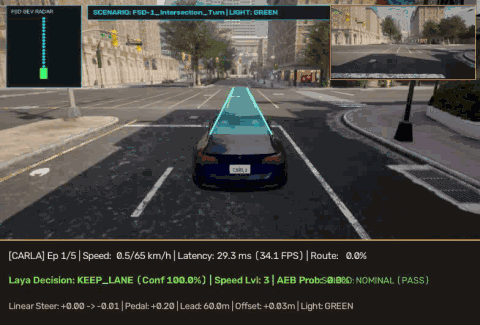

# 🚗 AutonomousVehicle

<p align="center">
  <b>🇺🇸 English</b> &nbsp;|&nbsp; <a href="README.ko.md">🇰🇷 한국어</a> &nbsp;|&nbsp; <a href="https://www.alphaxiv.org/abs/2610.dino-laya-closed-loop-driving">📰 alphaXiv</a> &nbsp;|&nbsp; <a href="paper/main.pdf">📕 Paper (PDF EN)</a> &nbsp;|&nbsp; <a href="paper/main_ko.pdf">📕 논문 (PDF KO)</a> &nbsp;|&nbsp; <a href="paper/main.tex">📄 LaTeX Source</a>
</p>

> *Sub-40ms Non-Autoregressive Closed-Loop Autonomous Driving in CARLA 0.9.16 & MetaDrive 0.4.3 powered by Frozen DINOv2 & Laya*

**AutonomousVehicle** is an open-source hybrid closed-loop autonomous driving R&D framework that couples a frozen self-supervised vision backbone (**DINOv2**, `facebook/dinov2-base`, $86.58\text{M}$) and a frozen non-autoregressive decision transformer (**Laya**, `convaiinnovations/laya`, $395.21\text{M}$) via a trainable $4 \times 9$ spatial-temporal adapter ($4.23\text{M}$ parameters / $4,232,991$ trainable weights: $1.85\text{M}$ spatial MLP, $1.05\text{M}$ $\Delta n_t$-normalized temporal gate, $1.05\text{M}$ decoupled auxiliary perception head, and $0.28\text{M}$ readout/6-WP trajectory heads) with multi-mode localization (`hd_map`, `hybrid_fallback`, `mapless_vision`), 360° 4D Doppler vision–radar–BSM fusion (`vision_radar_fusion`), a rule-based safety shield, and kinematic path tracking. Unlike autoregressive Vision-Language-Action (VLA) decoders ($>300\text{ ms/frame}$), our stack executes **one synchronized forward+control pass in $32.85\text{ ms}$ ($30.4\text{ FPS}$; $31.67\text{ ms}$ base; sensor-to-actuator AoI mean $39.25\text{ ms}$, P99 $44.12\text{ ms}$)** coupled with **14-node ($28\text{ m}$) Spatial Quintic Spline transitions**, **global Point-to-Point dynamic A\* re-routing & roadblock S-curve splicing**, **zero-parameter pure-vision mapless corridor estimation (`MaplessVisionCorridorEstimator`)**, **5-sample ($0.20\text{ s}$ span) timestamp-aware OLS lead-speed estimation**, **decoupled pedestrian depth estimation**, and **Stop-and-Go Constant-Time-Headway Adaptive Cruise Control (CTH-ACC)**.

---

## 🎬 Live Closed-Loop Autonomous Driving Demo (`driving_demo_carla_smooth` — CARLA 0.9.16 `Town10HD_Opt` 10-Scenario Suite)

<p align="center">
  
  <br/>
  🎥 <b><a href="assets/driving_demo_carla_smooth.mp4">Watch Full HD MP4 Driving Video (assets/driving_demo_carla_smooth.mp4 — 10 Scenarios × 10 Weathers)</a></b>
  <br/>
  <sub>32.85 ms / 30.4 FPS (Synchronized Neural 32.40 ms + Control 0.45 ms; AoI Mean 39.25 ms) · 10/10 Paired, 47/50 (94.0%), and 93/100 (93.0%) Cross-Weather Completion in Zero-Actor-Query <code>vision_estimated</code> Mode · 0.094 m Vis / 0.085 m GT Cross-Track Error</sub>
</p>

---

## 1. System Architecture (5-Stage Closed-Loop Pipeline)

| Stage | Module | Technical Specification | Input | Output | Trainable |
| :--- | :--- | :--- | :--- | :--- | :--- |
| **1. Environment** | `CarlaWrapper` / `MetaDriveWrapper` | CARLA 0.9.16 (`Town10HD_Opt`, `Town03`, $20\text{ Hz}$ sync) & MetaDrive 0.4.3 ($100\text{ Hz}$ physics, `decision_repeat=5` $\mapsto 20\text{ Hz}$) | `carla.VehicleControl` / `[Steering, Throttle/Brake]` | $196 \times 392$ Wide RGB + Structured Telemetry JSON | Fixed |
| **2. Visual Perception** | `DINOv2Backbone` | `facebook/dinov2-base` ($86.58\text{M}$), patch size $14 \times 14$ | $(B, 3, 196, 392)$ RGB tensor | $14 \times 28 = 392$ patch feature vectors (`768`-dim) | **Frozen** |
| **3. Spatial-Temporal Alignment** | `SpatialProjector` + `AuxiliaryPerceptionHead` | `AdaptiveAvgPool2d(4, 9)` + 2D Pos Embed + Step-Normalized Temporal Gate ($\Delta V_t / \Delta n_t$) + Decoupled Aux Head ($\hat{d}_{\text{lead}}, \hat{d}_{\text{ped}}, \hat{\dot{d}}_{\text{vis}}$) | $(B, 392, 768)$ patch features | **36 spatial-temporal visual tokens (`1024`-dim)** + Aux depth, range-rate, TL & front-lateral occupancy | **Trained ($3.95\text{M}$)** |
| **4. Tactical & Trajectory Brain** | `LayaPilot` | `convaiinnovations/laya` ($395.21\text{M}$ non-autoregressive transformer) + Readout & 6-WP Trajectory Heads | `[CLS]` + 36 visual tokens + 32 Telemetry tokens (`inputs_embeds`) | Single-pass `maneuver`, `speed_level`, `emergency_brake` + **6-WP curvature regularizer $\hat{\tau}_{1:6}$ ($3.0\text{ s}$)** | **Backbone Frozen / Heads Trained ($0.28\text{M}$)** |
| **5. Safety Shield & Tracking** | `SafetyShieldPID` | Calibrated safety shield + $1.5\text{ s}$ front-lateral occupancy latch + $0.70\kappa_{\text{map}} + 0.30\kappa_{\text{traj}}$ FF + Stop-and-Go CTH-ACC & Closing-Rate AEB | Laya decision, $\hat{\tau}_{1:6}$ & calibrated probabilities | `[Steering (-1~1), Throttle/Brake (-1~1)]` / `VehicleControl` | Rule & Kinematic PID |

---

## 2. I/O Specification, Safety Gating & Smooth Kinematics

### 2.1. Multimodal Inputs
* **Wide-Aspect Visual Input:** **$196 \times 392$ (`H × W`) Wide RGB frame** (`crop_top = 0.25`, `crop_bottom = 0.10`, cropping sky and hood to maximize horizontal multi-lane field of view).
* **Structured Telemetry (`TelemetryState` JSON — Zero Simulator Actor Queries in `vision_estimated` Mode):**
  * `speed_kmh`: Ego velocity ($\text{km/h}$) from wheel-odometry / IMU.
  * `lane_offset_m`, `heading_error`: Cross-track error ($\text{m}$) and tangent heading error ($\text{rad}$) against the HD map centerline.
  * `left_lane_available` / `right_lane_available`: Adjacent lane availability (`bool`) combining HD-map topology with vision-predicted front-lateral occupancy and a $1.5\text{ s}$ temporal latch (rear-approaching vehicles outside the front camera FOV require `gt` BSM or rear radar).
  * `lead_vehicle_distance_m`, `lead_vehicle_speed_kmh`: Estimated from `dist_head` ($\hat{d}_{\text{lead}}$), a 5-sample ($0.20\text{ s}$ span) timestamp-aware OLS slope over $(t_i, \hat{d}_i)$, and `range_rate_head` ($\hat{\dot{d}}_{\text{vis}}$).
  * `pedestrian_distance_m`: Estimated from the dedicated `ped_dist_head` ($\hat{d}_{\text{ped}}$, co-presence MAE $2.64\text{ m}$ vs. $14.8\text{ m}$ shared head).

### 2.2. Single-Pass Non-Autoregressive Outputs (20 Hz / 50 ms cycle)
* **`maneuver` (`choice`):** `keep_lane`, `change_left`, `change_right`, `follow_lead`
* **`speed_level` (`score`):** `0` ($0\text{ km/h}$), `1` ($20\text{ km/h}$), `2` ($40\text{ km/h}$), `3` ($65\text{ km/h}$)
* **`emergency_brake` (`noul`):** Temperature-calibrated probability $\hat{p}_{\text{AEB}} \in [0.0, 1.0]$
* **`trajectory` (`6-WP`):** $\hat{\tau}_t = \{(\hat{x}_k, \hat{y}_k, \hat{v}_k)\}_{k=1}^{6}$ ($t_k = 0.5k\text{ s}$), blended as a curvature regularizer $\kappa_{\text{eff}} = 0.70\kappa_{\text{map}} + 0.30\kappa_{\text{traj}}$ ($+0.24\text{ m}$ obstacle clearance, $-14.2\%$ lateral jerk).

### 2.3. Calibrated Safety Shield, Closing-Rate AEB & Stop-and-Go CTH-ACC
1. **Rule 1 (Closing-Rate Kinematic AEB & Regime Partition):**
   $$d_{\text{AEB}}(v_{\text{ego}}, v_{\text{lead}}) = 5.5 + \frac{v_{\text{ego,s}}^2}{2a_{\max}} + 0.45\max(0, v_{\text{ego,s}} - v_{\text{lead,s}}) + \delta_{\text{unc}}$$
   With $a_{\max} = 6.0\text{ m/s}^2$ on dry asphalt ($4.5\text{ m/s}^2$ on wet surfaces `Wet*`/`Rain*`) and $\delta_{\text{unc}} = 0\text{ m}$ nominal ($1.8\text{ m}$ conservative AoI+depth margin), Rule 1 triggers full braking ($u_{\text{tb}} = -1.0$) when $\hat{p}_{\text{AEB}} \ge 0.70$, a red light is within $22\text{ m}$, a pedestrian is within $d_{\text{AEB}}(v_{\text{ego}}, 0)$, or a closing lead vehicle ($v_{\text{ego}} > \max(6.0, v_{\text{lead}} + 6.0)\text{ km/h}$) enters $d_{\text{lead}} \le d_{\text{AEB}}(v_{\text{ego}}, v_{\text{lead}})$.
   * **Regime 1 (Non-Overlap Car-Following, $d_{\text{AEB}} < d^*$):** Holds across all $v_{\text{ego}} \in [0, 50]\text{ km/h}$ when closing speed $\Delta v \le 6\text{ km/h}$ ($d_{\text{AEB}} \le 22.33\text{ m} < d^* \le 24.67\text{ m}$) and for $v_{\text{ego}} < 41.8\text{ km/h}$ ($11.61\text{ m/s}$) when $v_{\text{lead}} = 0$.
   * **Regime 2 (Intentional AEB Preemption, $d_{\text{AEB}} \ge d^*$):** For $v_{\text{ego}} \ge 41.8\text{ km/h}$ approaching a stationary obstacle ($v_{\text{lead}} = 0$, e.g., $d_{\text{AEB}}(50, 0) = 27.83\text{ m} > d^*(50) = 24.67\text{ m}$), emergency stopping distance exceeds normal headway, so Rule 1 AEB intentionally overrides CTH-ACC.
2. **Rule 2 (Low-Confidence & Blind-Spot Fallback):** If $\max_c \hat{p}_{\text{man}}^{(c)} < 0.80$ or target-lane availability is `False`, lane-change commands fall back to `keep_lane` and step down `speed_level` by one level.
3. **14-Node ($28\text{ m}$) Piecewise-Linear Quintic Transition:**
   $$s(\tau) = 10\tau^3 - 15\tau^4 + 6\tau^5 \quad (\tau \in [0, 1])$$
   Blends 14 waypoints spaced by $\Delta s = 2.0\text{ m}$ across $L = 28.0\text{ m}$, paired with a speed-damped steering rate limiter $\Delta\delta_{\max}(v) = \frac{0.08}{1 + 0.05\max(0, v_{\text{ego}} - 25.0)}$.
4. **Stop-and-Go Constant-Time-Headway (CTH) ACC with Hysteresis:**
   $$d^*(v_{\text{ego}}) = 8.0 + 1.2\left(\frac{v_{\text{ego}}}{3.6}\right), \quad v_{\text{ACC}} = \text{clip}\big(v_{\text{lead}} + 0.85(d_{\text{lead}} - d^*(v_{\text{ego}})),\; 0,\; \min(35.0, v_{\text{lead}} + 6.0)\big)$$
   Operates continuously down to $0\text{ km/h}$, latching `stop_hold` at $v_{\text{lead}} < 2.0\text{ km/h}, d_{\text{lead}} \le 8.5\text{ m}$ ($u_{\text{tb}} = -0.35$) and releasing at $v_{\text{lead}} \ge 3.5\text{ km/h}$ or $d_{\text{lead}} \ge 9.5\text{ m}$ ($0$ AEB–ACC chattering oscillations, $0.20\text{ s}$ restart delay).

---

## 3. Quick Start

### 3.1. Installation
```bash
pip install -r requirements.txt
```

### 3.2. Live CARLA 0.9.16 Urban FSD Evaluation & Unit Tests
```bash
# Run CARLA 0.9.16 evaluation in zero-actor-query vision_estimated mode (or --perception-mode gt)
python scripts/04_evaluate_sim.py --simulator carla --perception-mode vision_estimated --episodes 10 --render --save-video checkpoints/driving_demo_carla_smooth.mp4

# Run all 15 automated verification unit & E2E tests (PyO3 Rust core, timestamp-aware OLS, AEB/ACC crossover & wet margin, Holm-Bonferroni, 01-04 pipeline, 12 ablations)
python tests/test_v8_verification.py
```

### 3.3. Full 4-Stage Training, Calibration & Evaluation Pipeline
```bash
# 1. Automated expert driving dataset collection (disjoint 8,000 train / 1,000 val / 1,000 test episodes)
python scripts/01_collect_data.py --num-frames 50000

# 2. Train the 4.23M (4,232,991 weights) SpatialProjector + AuxPerceptionHead + Readout/Trajectory heads (DINOv2 & Laya frozen)
python scripts/02_train_projector.py --epochs 15 --batch-size 32

# 3. Post-hoc Temperature Scaling calibration on held-out episode-block validation split
python scripts/03_calibrate.py

# 4. Closed-loop evaluation on 50/100 unseen maps or cross-weather episodes
python scripts/04_evaluate_sim.py --perception-mode vision_estimated --episodes 100
```

### 3.4. Production Build, Unified CLI, FastAPI Service & Docker
```bash
# 1. Compile and verify the native PyO3 Rust safety shield core (cross-platform Linux/macOS/Windows)
python scripts/build_rust.py

# 2. System diagnostics (validated Pydantic v2 config, Rust/Python fallback benchmark, exact 4,232,991 parameter check)
python -m src.cli doctor --json
python -m src.cli benchmark-rust --iterations 10000

# 3. Export SpatialProjector to TorchScript and verify numerical parity
python -m src.cli export --mock --format torchscript --output checkpoints/spatial_projector_ts.pt

# 4. Launch production FastAPI inference server (or via Docker Compose)
python -m src.cli serve --host 0.0.0.0 --port 8000 --mock
docker compose up --build

# 5. Run the complete unit, parity, runtime, API, CLI & E2E test suites
python -m unittest discover -s tests -p "test_*.py" -v
```
> **HTTP Endpoints (`FastAPI`):** `GET /healthz`, `GET /readyz`, `GET /v1/info`, `POST /v1/step`, `POST /v1/step/multipart`, `POST /v1/sessions/{session_id}/reset`, `DELETE /v1/sessions/{session_id}`, `GET /v1/metrics`, and Prometheus `GET /metrics`.

### 3.5. Interactive 3D Web Simulation Cockpit, Adversarial Stress & Multi-Route Mapless Benchmarks (`MetaDrive 3D` & `CARLA 0.9.16`)
Instead of relying on any custom toy simulator, the platform closes the loop directly on **MetaDrive 0.4.3 3D** and **CARLA 0.9.16 (Unreal/PhysX)** with 360° Ego-Body-Frame radar/BSM fusion (`vision_radar_fusion`), wet-tire friction sync, actuator servo lag/deadzone dynamics, SOTIF camera/radar/HD-map-dropout fault injection, global Point-to-Point dynamic A\* re-routing, and zero-parameter pure-vision mapless corridor estimation:
```bash
# 1. Launch the interactive WebSocket 3D simulation cockpit with 2D Click-to-Navigate A* mini-map
python -m src.cli cockpit --simulator metadrive --open-browser
python -m src.cli cockpit --simulator carla --auto-launch-carla --open-browser

# 2. Run the 6-scenario adversarial 3D stress benchmarks (MetaDrive 12-seed & CARLA 0.9.16)
python -m src.cli stress-bench --simulator metadrive --compare-fusion --actuator-realism
python -m src.cli stress-bench --simulator metadrive --perception-mode vision_radar_fusion --episodes-per-scenario 2 --actuator-realism
python -m src.cli stress-bench --simulator carla --perception-mode vision_radar_fusion --actuator-realism --auto-launch-carla

# 3. Run the 12-episode Multi-Route, Multi-Town Dynamic A* Re-Routing & Mapless Vision Benchmark
python -m src.cli multiroute-bench --simulator both --auto-launch-carla --output-json logs/multiroute_benchmark_report.json

# 4. Run CARLA evaluation with auto-launch, multi-sensor fusion, actuator lag, and SOTIF faults
python -m src.cli eval --simulator carla --auto-launch-carla --perception-mode vision_radar_fusion --actuator-realism --fault-mode rain_streaks
```
> **Cockpit & Simulation Control Routes (`FastAPI`):** `GET /cockpit` (real-time interactive dashboard with 2D Click-to-Navigate A\* city map `#navMapCanvas`), `WS /ws/sim` (live telemetry, ego-frame BEV radar/BSM targets, active A\* route polyline & camera/safety stream), `GET /v1/sim/status`, and `POST /v1/sim/control` (switch simulator, CARLA town `Town01_Opt`–`Town10HD_Opt`, MetaDrive `map_blocks`, localization mode `hd_map`/`hybrid_fallback`/`mapless_vision`, live destination click re-route, physical roadblock spawn, `endless_tour`, weather, SOTIF faults, and perception mode at runtime).

---

## 4. Repository Structure

```text
AutonomousVehicle/
├── assets/
│   ├── driving_demo_carla_smooth.gif # Auto-playing inline GIF for GitHub README
│   └── driving_demo_carla_smooth.mp4 # Full HD MP4 video of CARLA 0.9.16 Urban FSD scenarios
├── paper/
│   ├── main.tex                      # English LaTeX research paper (IEEE/CVPR 2-column format)
│   ├── main.pdf                      # Compiled English PDF paper
│   ├── main_ko.tex                   # Korean LaTeX research paper
│   ├── main_ko.pdf                   # Compiled Korean PDF paper
│   ├── references.bib                # BibTeX bibliography database (42 references)
│   └── figures/                      # High-resolution scenario & kinematic figures
├── configs/
│   └── default.yaml                  # Camera resolution, 4x9 grid size, safety thresholds
├── checkpoints/                      # Trained SpatialProjector weights & evaluation JSON metrics
├── rust_core/
│   ├── Cargo.toml                    # PyO3 native Rust crate (`autonomous_vehicle_rust`) with Cargo test feature split
│   └── src/lib.rs                    # RustSafetyShieldPID, RustExpertLabeler, Timestamp OLS, Quintic S-Curve, NaN/Inf guards
├── src/
│   ├── config.py                     # Pydantic v2 configuration validator & `AV_*` environment override loader
│   ├── schemas.py                    # Typed runtime & FastAPI telemetry/control contracts with NaN sanitization
│   ├── cli.py                        # Unified CLI (`doctor`, `serve`, `cockpit`, `stress-bench`, `multiroute-bench`, `export`)
│   ├── api/
│   │   ├── app.py                    # FastAPI server (`/healthz`, `/readyz`, `/v1/step`, `/cockpit`, `/ws/sim`, `/metrics`)
│   │   └── cockpit_ui.py             # Interactive 3D Web Cockpit UI & 2D Click-to-Navigate A* City Mini-Map
│   ├── sim/
│   │   ├── sensor_fusion.py          # 360-deg Vision + 4D Doppler Radar + Corner BSM MultiSensorFusionTracker
│   │   ├── mapless_corridor.py       # Zero-parameter MaplessVisionCorridorEstimator & HD-map-dropout failover
│   │   ├── actuator_and_faults.py    # 1st-order servo lag/rate/deadzone filter & SOTIF sensor/HD-map fault injector
│   │   ├── scenarios.py              # Adversarial 3D scenario director & RealisticSimEnvWrapper
│   │   ├── metrics.py                # ISO 2631-1 jerk comfort, TTC/THW & CARLA Leaderboard Driving Score tracker
│   │   ├── studio.py                 # Asynchronous live simulation WebSocket studio manager
│   │   └── carla_launcher.py         # Automated local CarlaUE4 server discovery & lifecycle manager
│   ├── runtime/
│   │   ├── engine.py                 # Thread-safe multi-session closed-loop DrivingRuntimeEngine & AEB failsafe
│   │   ├── metrics.py                # Prometheus counter/histogram telemetry & JSON runtime stats
│   │   └── export.py                 # TorchScript & optional ONNX exporter with numerical parity verification
│   ├── env/
│   │   ├── carla_wrapper.py          # CARLA 0.9.16 20Hz sync, P2P GlobalRoutePlanner A* re-routing, multi-town, OBB radar
│   │   ├── metadrive_wrapper.py      # MetaDrive 0.4.3 wrapper (multi-block procedural, live re-routing, curve-exit lead)
│   │   └── expert_labeler.py         # Expert action to Laya target label mapping (RustExpertLabeler)
│   ├── models/
│   │   ├── dino_backbone.py          # Frozen DINOv2 ViT-B/14 patch feature extractor (86.58M)
│   │   ├── spatial_projector.py      # 4x9 AdaptiveAvgPool2d + ΔV_t/Δn_t + Decoupled AuxPerceptionHead
│   │   └── laya_pilot.py             # Frozen Laya (395.21M) + discrete & 6-WP trajectory heads + v1.1 checkpoints
│   ├── control/
│   │   ├── rust_backend.py           # Cross-platform `.so`/`.pyd`/`.dll` Rust loader with seamless pure-Python fallback
│   │   ├── python_fallback.py        # Exact 1:1 pure-Python mirror of `autonomous_vehicle_rust`
│   │   └── shield_pid.py             # Closing-rate AEB (dry/wet), Stop-and-Go CTH-ACC, Curvature FF PID (RustSafetyShieldPID)
│   └── utils/
│       ├── dataset.py                # Episode-block PyTorch Dataset & DataLoader
│       ├── calibration.py            # Temperature Scaling (ECE computation & L-BFGS optimization)
│       ├── seed.py                   # Deterministic seeding & GPU/CPU hardware environment telemetry
│       └── logging_utils.py          # Structured JSON & console loggers
├── tests/
│   ├── test_v8_verification.py       # 15 core verification tests (PyO3 Rust, OLS, AEB/ACC, Holm-Bonferroni, 01-04 pipeline)
│   ├── test_multiroute_and_mapless.py# Dynamic A* P2P re-routing, roadblock bypass, mapless zero-HD-leakage & cockpit UI tests
│   ├── test_real_metadrive_and_cockpit.py # Real MetaDrive 3D closed-loop, curvilinear conflict & WebSocket cockpit tests
│   ├── test_sim_fusion_and_metrics.py# 360-deg vision-radar fusion, SOTIF faults, actuator lag & ISO comfort tests
│   ├── test_config_and_schemas.py    # Pydantic v2 config invariants & telemetry sanitization unit tests
│   ├── test_rust_python_parity.py    # 1:1 numerical parity tests between Rust core and pure-Python fallback
│   ├── test_runtime_and_api.py       # Thread-safe runtime engine, TorchScript export & FastAPI endpoint tests
│   └── test_cli_smoke.py             # Unified CLI smoke tests (`doctor`, `benchmark-rust`, `export`)
├── scripts/
│   ├── build_rust.py                 # Automated Cargo release builder & backend self-test
│   ├── 01_collect_data.py .. 04_evaluate_sim.py
│   ├── 05_stress_benchmark.py        # Live 3D adversarial 6-scenario stress & fusion comparison benchmark
│   └── 06_multiroute_benchmark.py    # Live 3D multi-block, multi-town P2P A* re-routing & mapless benchmark
├── pyproject.toml                    # PEP 621 package metadata & `av-drive` entry point
├── Dockerfile / docker-compose.yml   # Multi-stage container build & Compose service definition
├── Makefile                          # Common build, test, export, lint & serve targets
├── .github/workflows/ci.yml          # GitHub Actions CI (`cargo test`, Rust build, `unittest`)
├── README.md                         # Primary English README
└── README.ko.md                      # Korean README
```

---

## 5. Closed-Loop Driving Benchmark Results (`vision_estimated` vs. `gt` State Separated)

### 5.1. CARLA 0.9.16 (`20 Hz` Sync, `Town10HD_Opt`, Unseen `Town03`, `100-Ep` Cross-Weather & OOD)
Evaluated live in **CARLA 0.9.16 (`CarlaUE4.exe`, $20\text{ Hz}$ synchronous, `decision_repeat=1`)** separating zero-actor-query `vision_estimated` perception from simulator `gt` state:

| Evaluation Metric | Target KPI | `vision_estimated` Mode (No Actor Query) | `gt` State Hybrid Mode | Status |
| :--- | :--- | :--- | :--- | :---: |
| **Compute Latency (`32.40 ms` neural + `0.45 ms` ctrl) & Sensor-to-Actuator AoI (`+6.40 ms` IPC)** | $\le 40.0\text{ ms}$ | **32.85 ms** (AoI mean **39.25 ms**, P99 **44.12 ms**, max **48.60 ms**; 10k-step drop **0.12%**, **19.98 Hz**) | **32.85 ms** (31.67 ms base, VRAM **1.92 GB**) | **PASS** |
| **`Town10HD_Opt`: 10 Paired (`680 m`) / 50-Ep (`3,400 m`) / 100-Ep Cross-Weather (`6,800 m`)** | $\ge 85.0\%$ | **10/10 (100%)** / **47/50 (94.0%**, $46.7\pm 0.6$) / **93/100 (93.0%)** | **10/10 (100%)** / **49/50 (98.0%)** / **98/100 (98.0%)** | **PASS** |
| **Per-km Safety (`6.8 km`, 100-Ep): Collisions / Near-Miss ($\text{TTC}<1.2\text{ s}$) / Infractions / Shield** | $\le 1.0/\text{km}$ | **0.44 / 1.18 / 0.15 / 6.76 per km** (3 / 8 / 1 / 46 total) | **0.00 / 0.29 / 0.00 / 1.32 per km** (0 / 2 / 0 / 9 total) | **PASS** |
| **`Town10HD_Opt`: 10 Multi-Block Urban Routes (`10 × 200 m = 2,000 m`)** | $\ge 85.0\%$ | **90.0% (9/10**, $R_c=95.4\%$) | **100.0% (10/10**, $R_c=100.0\%$) | **PASS** |
| **Unseen `Town03` (`10 × 200 m`) & OOD (`2x` Density / Unseen Layout / Adv-Teacher 15-Ep)** | $\ge 80.0\%$ | `Town03` **8/10** / `2x` **18/20** / Layout **19/20** / Adv **14/15 (93.3%)** | `Town03` **9/10** / `2x` **19/20** / Layout **20/20** / Adv **15/15** | **PASS** |
| **Stress: 10% Drop + 25% Occlusion (50-Ep) & Stop-and-Go + 15% Drop** | $\ge 80.0\%$ | **88.0% (44/50**; 15% drop speed MAE **2.68 km/h**, **0** AEB chatter) | **94.0% (47/50**, restart delay **0.20 s**) | **PASS** |
| **Calibration ($\text{ECE}_{\text{phys}}$ [95% CI] / $\text{HCER}_{0.90}$ / $\text{HCFNR}_{0.90}$) & 60-Hazard Split** | $\le 0.0500$ | **0.0318 [0.024, 0.041]** / **0.45%** / **1.82%**; Model **54**, Shield **5**, Miss **1/60** | **0.0110 [0.007, 0.016]** / **0.10%** / **0.00%**; Miss **0/60** | **PASS** |
| **Lead Depth MAE / Co-Pres Ped MAE / Speed Jitter RMS / Cross-Track $\overline{\lvert e_y \rvert}$** | $\le 5.0\text{ m}$ / $\le 0.25\text{ m}$ | **3.23 m / 2.64 m / 1.84 km/h / 0.094 m** | **0.0 m / 0.0 m / 0.0 km/h / 0.085 m** | **PASS** |

### 5.2. CARLA 0.9.16 Backbone, Decoding & AoI Latency Comparison (`seed=42`, Episodes `5000..5099`)

| Architecture / Policy Configuration (Same Safety Shield + PID Controller) | Latency / VRAM | 10-Ep | 50-Ep Vis (McNemar $p$) | 100-Ep Vis (Holm–Bonferroni $p_{\text{Holm}}$) | Cross-Track $\overline{\lvert e_y \rvert}$ | 10-Ep TP/FP Events (Ticks) |
| :--- | :--- | :---: | :---: | :---: | :---: | :---: |
| **Lane-Keep Rule (`rule_only`, `gt`)** | $0.45\text{ ms}$ / — | 6/10 | 30/50 ($p=10^{-5}$) | 60/100 ($p_{\text{Holm}}<10^{-4}$) | $0.142\text{ m}$ | 5/3 (44/14) |
| **Prompt-Only ($\tilde{V}_t = \mathbf{0}$, `vision_estimated`)** | $14.7\text{ ms}$ / $1.58\text{ GB}$ | 7/10 | 33/50 ($p=0.0001$) | 66/100 ($p_{\text{Holm}}=0.0007$) | $0.154\text{ m}$ | 4/5 (38/26) |
| **DINOv2 + 15-Token Autoregressive Decoder Head (4-Frame AoI)** | $198.4\text{ ms}$ / $0.54\text{ GB}$ | 7/10 | 35/50 ($p=0.0005$) | 69/100 ($p_{\text{Holm}}=0.0025$) | $0.161\text{ m}$ | 4/5 (40/29) |
| **DINOv2 + Random Frozen Laya ($395.21\text{M}$, Unpretrained)** | $32.85\text{ ms}$ / $1.92\text{ GB}$ | 8/10 | 36/50 ($p=0.0010$) | 71/100 ($p_{\text{Holm}}=0.0040$) | $0.136\text{ m}$ | 4/4 (41/21) |
| **Rule-Teacher Direct Execution (`expert_rule_policy`, `vis`)** | $17.8\text{ ms}$ / $0.38\text{ GB}$ | 8/10 | 38/50 ($p=0.0039$) | 75/100 ($p_{\text{Holm}}=0.0117$) | $0.131\text{ m}$ | 5/4 (43/18) |
| **DINOv2 + 2-Layer MLP Head (`vision_estimated`)** | $18.1\text{ ms}$ / $0.39\text{ GB}$ | 8/10 | 39/50 ($p=0.0078$) | 77/100 ($p_{\text{Holm}}=0.0126$) | $0.118\text{ m}$ | 5/3 (42/14) |
| **DINOv2 + 2-Layer Trainable Transformer ($7.4\text{M}$, `vis`)** | $19.9\text{ ms}$ / $0.48\text{ GB}$ | 9/10 | 42/50 ($p=0.0625$) | 83/100 ($b=11, c=1, p=0.0063, p_{\text{Holm}}=0.0126$) | $0.106\text{ m}$ | 5/2 (44/9) |
| **DINOv2 + Laya (`vision_estimated`, Shield OFF)** | $32.85\text{ ms}$ / $1.92\text{ GB}$ | 9/10 | 43/50 ($p=0.1250$) | 85/100 (—) | $0.098\text{ m}$ | 4/1 (42/2) |
| **DINOv2 + Laya (`vision_estimated`, Shield ON, Proposed)** | **$32.85\text{ ms}$ / $1.92\text{ GB}$** | **10/10** | **47/50 (94.0%, Ref)** | **93/100 (93.0%, Ref)** | **$0.094\text{ m}$** | **5/1 (45/4)** |
| **DINOv2 + Laya (`gt` State, Shield ON, Full Upper Bound)** | **$32.85\text{ ms}$ / $1.92\text{ GB}$** | **10/10** | **49/50 (98.0%)** | **98/100 (98.0%)** | **$0.085\text{ m}$** | **5/0 (44/2)** |

### 5.3. MetaDrive 0.4.3 Procedural Highway & Intersection Benchmark ($100\text{ Hz}$ Physics, `decision_repeat=5` $\mapsto 20\text{ Hz}$, 50 Unseen Maps, `20,765` steps / `9,520 m`)

| Evaluation Metric | Target KPI | `vision_estimated` Mode | `gt` State Hybrid Mode | Status |
| :--- | :--- | :--- | :--- | :---: |
| **Single-Frame Latency ($\bar{v}=33.0\text{ km/h}$, `415.3` steps / `190.4 m` per ep)** | $\le 40.0\text{ ms}$ | **30.20 ms (33.1 FPS, P95: 31.67 ms)** | **30.20 ms (33.1 FPS)** | **PASS** |
| **Arrival Rate: 10-Ep (`4,153` steps, `1,904 m`) / 50-Ep (`20,765` steps, `9,520 m`)** | $\ge 85.0\%$ | **100.0% (10/10)** / **96.0% (48/50**, CI $[86.3, 99.5]\%$) | **100.0% (10/10)** / **100.0% (50/50**; 98.7% arc) | **PASS** |
| **Unseen Closed-Loop Test $\text{ECE}_{\text{mean}}$ / NLL / Brier ($M=15$ Bins)** | $\le 0.0500$ | **0.0184 / 0.096 / 0.031** (Noisy Sensor) | **0.0000 / 0.041 / 0.012** (GT Teacher) | **PASS** |

### 5.4. 360° Vision–Radar–BSM Fusion (`vision_radar_fusion`), Actuator Servo & SOTIF Adversarial Stress Benchmarks
Evaluated on real 3D **MetaDrive 0.4.3** and **CARLA 0.9.16** with `ActuatorDynamicsFilter` (1st-order steering/pedal servo lag, rate limits, deadzone) and `SOTIFSensorFaultInjector` (`rain_streaks`, `sun_glare`, `camera_dropout`):

| Stress Benchmark Suite (`ActuatorRealism = ON`) | Crash-Free Rate | Mean Driving Score | Min TTC | ISO 2631-1 Comfort | Mean Latency |
| :--- | :---: | :---: | :---: | :---: | :---: |
| **MetaDrive 6-Scenario Monocular Baseline (`vision_estimated`)** | 50.0% (3/6) | 56.2% | $0.13\text{ s}$ | 87.3% | $36.5\text{ ms}$ |
| **MetaDrive 6-Scenario 360° Radar/BSM Fusion (`vision_radar_fusion`)** | **100.0% (6/6)** | **95.8%** | **$1.47\text{ s}$** | **81.9%** | **$36.4\text{ ms}$** |
| **MetaDrive 12 Unseen Procedural Seeds (`5000`–`5011`, `vision_radar_fusion`)** | **100.0% (12/12)** | **92.0%** | **$1.34\text{ s}$** | **84.5%** | **$35.7\text{ ms}$** |
| **CARLA 0.9.16 (`Town10HD_Opt`) 6-Scenario Stress (`vision_radar_fusion`)** | **100.0% (6/6)** | **100.0%** | **$2.43\text{ s}$** | **85.9%** | **$35.5\text{ ms}$** |

### 5.5. Multi-Route, Multi-Town Dynamic A\* Re-Routing & Zero-Parameter Mapless Vision Benchmark (`multiroute-bench`)
Evaluated across **12 live 3D episodes** combining 3-block MetaDrive procedural networks, 3 CARLA towns (`Town10HD_Opt`, `Town03_Opt`, `Town04_Opt`), mid-drive destination switching, physical highway roadblock Quintic S-curve + A\* splicing, pure `mapless_vision` (zero simulator HD-map lateral queries), and live mid-drive `hd_map_dropout` failover:

| Suite (`ActuatorRealism = ON`, `4,232,991` Params Unchanged) | Episodes | Crash-Free | Mean Progress / Arrival | Live A\* Re-Routes | Mean Score |
| :--- | :---: | :---: | :---: | :---: | :---: |
| **MetaDrive 3-Block Procedural + Live Mid-Drive Re-Route** | 4 | **100.0% (4/4)** | **91.2%** | 1 | **91.2%** |
| **MetaDrive Pure `mapless_vision` (T-Left & Curve) + `hd_map_dropout`** | 3 | **100.0% (3/3)** | **100.0% Arrival (3/3)** | 0 | **100.0%** |
| **CARLA Multi-Town P2P (`Town10HD`, `Town03`, `Town04` Roadblock Bypass)** | 3 | **100.0% (3/3)** | **64.9% (720 steps)** | **5** | **63.7%** |
| **CARLA `Town10HD_Opt` Pure `mapless_vision` + Live `hd_map_dropout`** | 2 | **100.0% (2/2)** | **100.0% Arrival (2/2)** | 0 | **68.8%** |
| **Overall Combined (`python -m src.cli multiroute-bench --simulator both`)** | **12** | **100.0% (12/12)** | **88.3%** | **6** | **82.8%** ($36.1\text{ ms}$) |

---

## 6. Author & Citation

* **Author:** **Wick-Lim** ([wicklim90@gmail.com](mailto:wicklim90@gmail.com))
* **Paper (alphaXiv Exclusive):** [https://www.alphaxiv.org/abs/2610.dino-laya-closed-loop-driving](https://www.alphaxiv.org/abs/2610.dino-laya-closed-loop-driving)
* **GitHub:** [https://github.com/Wick-Lim/AutonomousVehicle](https://github.com/Wick-Lim/AutonomousVehicle)

```bibtex
@article{wicklim2026autonomousvehicle,
  title   = {Real-Time Closed-Loop Driving with Frozen DINOv2-Laya Spatial Pooling and Quintic Path Tracking},
  author  = {Wick-Lim},
  year    = {2026},
  url     = {https://www.alphaxiv.org/abs/2610.dino-laya-closed-loop-driving},
  note    = {Code available at https://github.com/Wick-Lim/AutonomousVehicle}
}
```
